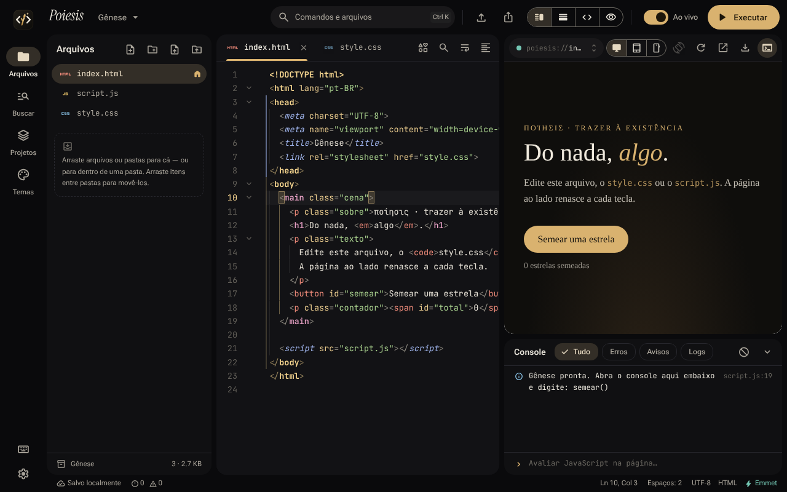

# Poiesis

> **ποίησις** (*poíēsis*) — para os gregos, o ato de trazer à existência o que antes não era.
> Código vira forma.

Extensão do Chrome que abre um editor de código web numa aba: HTML, CSS e JavaScript com realce de sintaxe estilo VS Code, preview ao vivo ao lado, console de verdade e importação de projetos inteiros.



**O ícone:** um `</>` cuja barra brota — o caule dourado nasce no meio da sintaxe e abre em folha e botão. Para Heidegger, a *physis* (a flor que desabrocha) é a forma mais alta de *poiesis*; aqui, o código é a semente.

## Instalar

1. Descompacte `Poiesis.zip`.
2. Abra `chrome://extensions` e ligue o **Modo do desenvolvedor**.
3. Clique em **Carregar sem compactação** e escolha a pasta `Poiesis`.
4. Clique no ícone da extensão (ou `Alt+Shift+P`) para abrir o editor.

## O que tem

**Interface em Material Design 3** — navigation rail (Arquivos, Buscar, Projetos, Temas), top app bar, painéis em superfícies tonais arredondadas, chips de filtro, botões segmentados, switches, menus, diálogos, tooltips e snackbars no padrão M3, com ripple.

**9 temas** que mudam interface e editor juntos: Tinta & Ouro (padrão), Drácula (paleta oficial), One Dark, Monokai, Nord, Tokyo Night, Catppuccin Mocha, Solarizado Claro e Papel & Ouro (claro).

**Editor (CodeMirror 6)**
- Realce de sintaxe por token, com **tags estruturais diferenciadas**: `<html>`, `<head>`, `<body>` e `<!DOCTYPE>` em destaque próprio e negrito; metadados (`meta`, `link`, `title`, `script`, `style`) em itálico; seções semânticas (`header`, `main`, `section`, `h1`…) e elementos customizados em cores próprias; faixas laterais marcam as regiões do head e do body.
- Seleção sempre visível (com e sem foco), multicursor, dobra de código, guias de indentação, seletor de cor no CSS, Emmet.
- **Autocompletar ampliado**: descrição em português de tags, atributos, propriedades CSS e APIs JS; classes e ids do CSS dentro de `class=""`/`id=""` e vice-versa nos seletores; caminhos do projeto em `href`, `src`, `url()`, `fetch()` e `import`; `var(--…)`, nomes de `@keyframes`, eventos de `addEventListener`, seletores em `querySelector` e `classList`, funções de outros arquivos JS e snippets (`log`, `qs`, `ael`, `fetchjson`, `forof`…).
- **Definições**: cartão "o que é e para que serve" para tags, atributos, propriedades, pseudo-seletores e APIs — e, para classes, ids, variáveis e animações do projeto, onde são definidas e onde são usadas (clicáveis). Aparece ao passar o mouse, com `Alt+F1` ou pelo menu de contexto.
- **Ir para definição** (`F12` / `Ctrl+clique`) e **renomear em todo o projeto** (`F2`) classes, ids, variáveis CSS e keyframes.
- **Seletor de ícones Material Symbols** (`Alt+I`, menu de contexto ou botão na barra de abas): 3.932 ícones com prévia offline, busca em português ou inglês ("casa", "lixeira", "seta"…), estilos Outlined/Rounded/Sharp, preenchimento, peso e tamanho. Insere o `<span>` (ou só o nome, ou o CSS) e adiciona o `<link>` da fonte no `<head>` se faltar. Com o cursor num ícone existente, troca o ícone.
- **Autocompletar ainda mais amplo**: ao digitar ``; atributos `data-*` do projeto (HTML, `[data-…]` no CSS e `dataset.` no JS); chaves do `localStorage`; fontes do projeto em `font-family`; tags em `createElement`; propriedades em camelCase em `.style.`; arquivos em `.src =`, `new Image/Audio/Worker()` e `@import`; valores sugeridos para `rel`, `target`, `loading`, `meta name/content`, `role`, `autocomplete`…
- **Verificação ao vivo com correção rápida**: tags inexistentes (`<dvi>` → `<div>`), atributos (`hreff` → `href`), propriedades CSS (`colr` → `color`), valores (`display: flx` → `flex`), `var(--…)` não definidas, pseudo-classes, fechamentos trocados ou faltando, ids duplicados, `` sem `alt`, caminhos de arquivos que não existem (ou que só funcionam por sorte), métodos e globais de JS digitados errado (`document.querySelecter`, `consle`), `getElementById`/`querySelector` com id ou classe que não existe no projeto, erros de sintaxe e JSON inválido. Sublinhado vermelho (erro), amarelo (aviso) ou pontilhado (dica); **clique no trecho** (ou `Ctrl+.`) para ver as sugestões e aplicar com um clique — também aparecem no topo do menu de contexto. `F8` vai para o próximo problema.
- **JSON, Markdown e texto**: JSON com realce, validação (mensagens em português, correção de vírgula sobrando e aspas simples) e formatação; Markdown com realce (inclusive blocos de código HTML/CSS/JS/JSON), formatação e pré-visualização ao lado, só código ou só visualização — imagens e links do projeto funcionam; `.txt` e `.md` com corretor ortográfico do navegador.
- **Menu de contexto** com definição, ir para definição, renomear, mostrar o elemento no preview, recortar/copiar/colar, comentar, formatar, operações de linha, maiúsculas/minúsculas, dobrar/desdobrar, ações do Emmet e busca no projeto.

**Histórico local** — versões do projeto sem Git nem nuvem:
- Guarda uma versão sozinho depois de alguns segundos sem editar, e antes de excluir, importar, substituir ou restaurar.
- Pontos manuais com nome e nota, que podem ser fixados.
- Comparação lado a lado ou em linha, com o estado atual ou com a versão anterior.
- Restauração de um trecho, de um arquivo ou do projeto inteiro, sempre com volta.
- Exportar e importar com verificação por hash.

**Rede e APIs** (aba "Rede" ao lado do Console):
- Registra `fetch` e XHR com status, tempo, cabeçalhos, corpo e de onde vieram. Recursos como `` e `<script>` aparecem sem detalhes, porque o navegador não os expõe.
- Diagnóstico que separa CORS, sem conexão, timeout e erro HTTP.
- Tokens, cookies e senhas ficam mascarados por padrão e sempre no HAR exportado.
- **Mocks** em `poiesis.mocks.json`: respostas simuladas com latência, falha ou timeout, que funcionam offline. Dá para criar um mock a partir de uma resposta real.
- **Console de APIs** para montar e repetir requisições, enviadas de dentro do preview, como a sua página faria.

**Inspetor de elementos** (aba "Elementos", `Ctrl+Shift+C`):
- Clique num elemento do preview para selecioná-lo, sem que o clique chegue à página. A árvore DOM marca os elementos criados por script.
- Regras que casam com o elemento, com arquivo e especificidade, declarações vencidas riscadas, valores calculados, variáveis CSS e box model.
- Force `:hover`, `:focus` e outros estados, e teste mudanças temporárias: nada vai para o arquivo até você copiar o CSS gerado.
- "Ver no código" leva à tag no HTML ou à regra no CSS; no editor HTML, `Ctrl+Shift+C` seleciona no preview o elemento sob o cursor.
- **Aplicar no código:** grava as mudanças nos arquivos quando o lugar é inequívoco (regra única no mesmo contexto, elemento que existe no HTML), com versão antes no histórico. Quando não dá, explica o motivo e oferece copiar o CSS.

**Extension Studio** (painel "Extensão"):
- Crie extensões para Chrome e Edge (Manifest V3) a partir de modelos: popup, opções, painel lateral, content script, service worker e o par principal/complementar.
- Edite o `manifest.json` num formulário ou no JSON, sincronizados, sem perder campos que o formulário não conhece.
- Validação antes de exportar: arquivos que faltam, chaves do MV2, CSP do MV3 (scripts inline, `onclick`), APIs `chrome.*` sem a permissão. Muitas têm correção de um clique.
- Cada permissão explicada, com o risco e o aviso que aparece na instalação. Gerador de ícones PNG.
- Preview do popup, das opções e do painel lateral com as APIs `chrome.*` **simuladas** (e marcadas como simulação). Service worker e content scripts só rodam com a extensão instalada.
- **Simulação do chrome.*:** `chrome.storage` inicial, abas fictícias e respostas simuladas para mensagens ao service worker, aos content scripts e a outras extensões, num arquivo do projeto (`poiesis.chrome.json`) que fica fora do ZIP.
- Exporta um ZIP pronto para "Carregar sem compactação" em `chrome://extensions`.

**Companheiros e música de foco:**
- **Pólen** (o broto curioso) ou **Lúmen** (a luz serena) fazem companhia na barra lateral: reagem com gestos ao que você faz (criar um arquivo, executar sem erros, um erro, exportar) e dormem quando você para. Nunca falam, nunca cobram atenção e nunca ficam na frente do código. Níveis Foco, Discreto e Vivo, ou nenhum, nas Preferências.
- **Música de foco** (botão de fone na barra superior): "Jardim de Luz", uma faixa original do Poiesis, gerada por código, em loop sem emenda, com volume e pausa automática. Vem dentro da extensão; nada é transmitido.

**Pasta no computador** (opcional; ligue em Preferências):
- Abra uma pasta real do computador ou vincule um projeto a uma pasta. As edições são gravadas direto nos arquivos, só os que mudaram.
- Criar, renomear e excluir no explorador também valem na pasta. `node_modules`, `.git`, `dist`, o `.gitignore` e o que você configurar ficam de fora.
- Mudanças feitas fora do Poiesis (VS Code, git) entram sozinhas.
- Se você e outro programa mexerem no mesmo arquivo ao mesmo tempo, as duas versões ficam no histórico e o comparador abre.
- Sem acesso à pasta (permissão, pasta movida ou apagada), o projeto fica somente leitura até reconectar ou desvincular.
- Não pede nenhuma permissão nova à extensão: o navegador pergunta pasta por pasta.

**Projeto**
- Pastas de verdade: criar, renomear, mover e excluir; arrastar arquivos e pastas entre elas; soltar arquivos do computador direto numa pasta.
- Importar **adicionando** ao projeto (sem substituir nada — nomes repetidos ganham sufixo), **mesclando** ou como **projeto novo**, escolhendo a pasta de destino.
- Busca e substituição em todos os arquivos.
- Exportar em `.zip` (com pastas) ou HTML único; vários projetos, modelos, backup.

**Preview e console**: `localStorage`, `sessionStorage` e `document.cookie` funcionam no preview (a sandbox bloqueia os nativos; o Poiesis fornece substitutos e guarda o localStorage por projeto), preview ao vivo sem piscar, modos tablet/celular, janela destacada sincronizada, módulos ES e `fetch` de arquivos do projeto, console com objetos expansíveis, REPL e link `arquivo:linha`.

## Atalhos

| Ação | Atalho |
| --- | --- |
| Executar | `Ctrl+Enter` ou `Ctrl+S` |
| Paleta de comandos | `Ctrl+K` |
| Abrir arquivo | `Ctrl+P` |
| Buscar no projeto | `Ctrl+Shift+F` |
| Definição / ir para definição | `Alt+F1` / `F12` |
| Renomear no projeto | `F2` |
| Inserir / trocar ícone | `Alt+I` |
| Correções rápidas / próximo problema | `Ctrl+.` / `F8` |
| Importar arquivos | `Ctrl+O` |
| Formatar | `Shift+Alt+F` |
| Buscar / substituir | `Ctrl+F` / `Ctrl+H` |
| Comentar linha | `Ctrl+/` |
| Quebra de linha | `Alt+Z` |
| Barra lateral / console | `Ctrl+B` / `Ctrl+J` |
| Alternar layout | `Ctrl+\` |
| Recarregar preview | `Ctrl+R` |
| Inspecionar elemento | `Ctrl+Shift+C` |

## Roadmap

Planejamento e histórico das fases em [`ROADMAP.md`](ROADMAP.md).

## Privacidade

O Poiesis não coleta nenhum dado: projetos e configurações ficam só no armazenamento local do navegador, e a extensão não faz requisições de rede. Os detalhes estão em [`PRIVACIDADE.md`](PRIVACIDADE.md).

## Como funciona a segurança

O código do usuário roda numa **página sandbox** declarada no manifesto: origem isolada, sem acesso às APIs da extensão nem aos seus dados. É isso que permite scripts inline, `eval` e bibliotecas de CDN no preview, enquanto as páginas da extensão continuam com a CSP rígida do Manifest V3. O editor só aceita mensagens vindas do iframe do preview, e o console do preview só aceita comandos da página sandbox que o hospeda. As únicas permissões pedidas são `storage` e `unlimitedStorage`, para guardar os projetos no próprio navegador.

## Desenvolver

```bash
pnpm install
pnpm icons   # recorta a fonte Material Symbols só com os ícones usados (precisa de Python + fonttools + brotli)
pnpm build   # gera a extensão em dist/
```

Stack: React 19, TypeScript, Vite, Tailwind, Radix/shadcn (reestilizado em Material 3), CodeMirror 6, núcleo do Emmet (com integração própria em `src/editor/emmet.ts`), Prettier, fflate. Fontes locais: Roboto Flex, JetBrains Mono, Instrument Serif, Lavishly Yours (títulos) e Material Symbols Rounded. O ícone sai de `design/icon.svg` (`cd design && python3 render.py`). Descrições de reserva do MDN via `@vscode/web-custom-data` (`python3 design/build_mdn.py`).

`pnpm test:e2e` roda os testes de ponta a ponta em `tests/e2e/` contra o `dist/` (precisa de Python com Playwright e Chromium). `pnpm promo` regenera as imagens promocionais em `store/`. O texto da ficha da Chrome Web Store, as justificativas de permissão e as respostas da aba de privacidade estão em [`store/FICHA.md`](store/FICHA.md).

A música de foco é gerada por `python3 design/musica/compor.py` (precisa de numpy, scipy e ffmpeg com libopus) e sai em `public/audio/`.

O build também gera `dist/LICENSE` e `dist/THIRD_PARTY_LICENSES.txt`, que traz a licença de cada pacote que entra na extensão.

## Licença

Copyright (C) 2026 Cauã F. O.

O Poiesis é software livre, distribuído sob a **GNU General Public License v3, somente a versão 3** (`GPL-3.0-only`). Você pode usar, estudar, modificar e redistribuir o código. Quem distribuir uma versão modificada precisa publicar o código-fonte dela também sob a GPL-3.0. O texto completo está em [`LICENSE`](LICENSE).

Os componentes de terceiros mantêm as próprias licenças. Destaque para as descrições do MDN em `src/lib/mdn-data.json`, que são CC BY-SA 2.5. Os detalhes estão em [`THIRD_PARTY_NOTICES.md`](THIRD_PARTY_NOTICES.md).
